# HW9 — Solving Problems with Search

**Task (請用搜尋法解決下列問題):** solve five problems with search algorithms and explain the methods.

| # | Problem | Method | File |
|---|---|---|---|
| 1 | Rat in a maze (老鼠走迷宮) | DFS | `maze_dfs.py` |
| 2 | Wolf, goat, cabbage river crossing (狼羊甘藍菜過河) | BFS | `river_bfs.py` |
| 3 | Eight queens (八皇后) | DFS + backtracking | `queens_dfs.py` |
| 4 | NPC searching for the player (NPC 搜尋玩家) | A* | `npc_astar.py` |
| 5 | IC wire routing (IC 電路繞線) | Lee, Hadlock, Soukup, A*, A* with bend penalty, net ordering, rip-up & reroute | `ic_routing.py` |

* `test_search.py` — checks for all five problems (`python test_search.py`, or `pytest`)
* `visualize.py` — draws every figure in `images/` from the solvers' real output
* `results.txt` — the full text output of the five scripts

Run any solver with `python <file>.py` (pure Python 3, no extra packages). `python visualize.py`
needs `matplotlib` and `numpy`.

---

## 0. EasySummary

* **All five are "search a state space" problems.** You define a *state*, the *moves* from one
  state to the next, and a *goal*. Then you choose the order in which to explore the states:
  * **DFS** goes deep first and backtracks at dead ends. It needs little memory and fits
    "find any solution" or "find all solutions" (maze, eight queens).
  * **BFS** goes level by level, so the first time it reaches the goal it used the fewest
    moves (river crossing).
  * **A\*** goes to the state with the smallest `g + h` (cost so far + estimated cost left).
    It finds the cheapest path while expanding fewer states than Dijkstra or BFS (NPC).
* **Maze:** DFS found a path of **24 steps** after visiting 42 cells; BFS shows the shortest is **16**.
  DFS finds *a* path, not necessarily the shortest one.
* **River:** BFS finds the minimum of **7 crossings**. There are exactly **2** shortest solutions.
* **Eight queens:** **92** solutions (**12** distinct up to rotation and reflection). Backtracking
  needs 15,720 column tries (about 2 ms). Brute force over 8^8 = 16.7 M placements took 8.3 s.
* **NPC:** A* finds the cheapest path (cost **35**) and expands **59** cells, against 94 for
  Dijkstra. BFS and greedy best-first take fewer steps, but those paths go through the swamp
  and cost 55.
* **IC routing:** Lee, Hadlock and A* always give the shortest wire. Soukup is faster but not
  always shortest (31 vs 29). A* with a bend penalty cuts bends from 8 to 2. With many nets,
  routing order matters, and **rip-up & reroute** fully routed **78/200** random chips, against
  39 for shortest-first ordering and 25 for the given order.

---

## 1. Rat in a Maze — DFS

### 1.1 Model

* **State:** the rat's cell `(row, col)`.
* **Moves:** go right, down, left or up, into a cell that is not a wall `#`.
* **Goal:** reach `E`.

The maze is an 11 × 11 grid written as text in `MAZE_TEXT` (`#` = wall). It is drawn below
in 1.3.

### 1.2 Algorithm

DFS walks forward as far as it can. When every neighbour is a wall or already visited, it
**backtracks** (undoes the last step) and tries the next direction.

```python
def go(cell):
    visited.add(cell)
    path.append(cell)              # step forward
    if cell == end:
        return True
    for nxt in neighbours(grid, cell):      # order: right, down, left, up
        if nxt not in visited and go(nxt):
            return True
    path.pop()                     # dead end -> backtrack
    return False
```

The `visited` set is essential: without it, the rat would walk around a loop forever.
`dfs_iterative` does the same with an explicit stack, which avoids Python's recursion limit
on big mazes.

### 1.3 Result

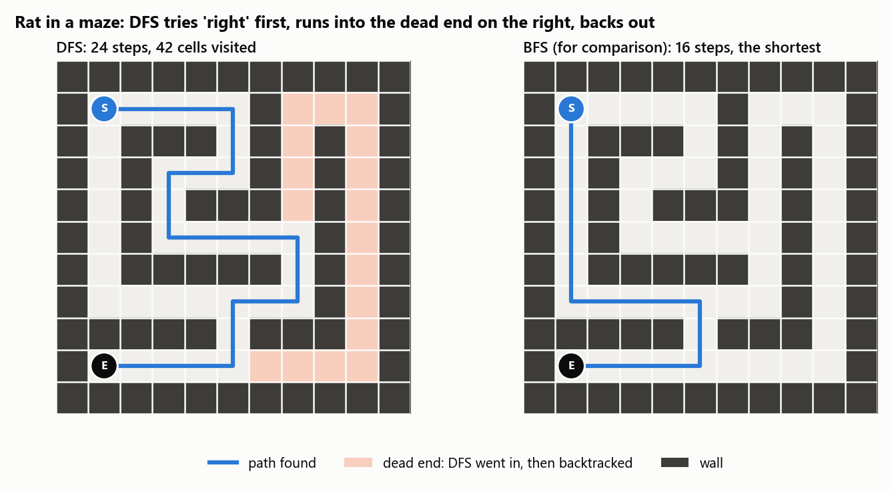

| | Steps | Cells visited |
|---|---|---|
| recursive DFS | 24 | 42 |
| iterative DFS | 24 | 42 |
| BFS (shortest, for comparison) | 16 | — |

Because "right" is tried first, DFS takes the long way. It first runs into the right half of
the maze, which is a dead end (orange), then backtracks to (9,5) and turns left to the exit.
The path is valid but 8 steps longer than BFS's.

**Complexity:** O(V + E) = O(rows × cols) time and memory. Each cell is visited at most once.

---

## 2. Wolf, Goat and Cabbage — BFS

### 2.1 Model

* **State:** which bank each of (farmer, wolf, goat, cabbage) is on, as `0` = start and
  `1` = goal. For example, `(1,0,1,0)` means the farmer and goat are across. There are 2^4 = 16
  states.
* **Moves:** the farmer crosses alone, or with **one** item that is on his bank.
* **Safety:** a state is forbidden if, without the farmer, the wolf is with the goat or the
  goat is with the cabbage. Only **10** of the 16 states are safe.
* **Goal:** `(1,1,1,1)`.

```python
def is_safe(state):
    f, w, g, c = state
    if w == g != f:   return False     # wolf eats goat
    if g == c != f:   return False     # goat eats cabbage
    return True
```

### 2.2 Algorithm

BFS uses a **queue** (FIFO): it explores every state reachable in 1 crossing, then in 2, and
so on. So the first time it reaches the goal, the number of crossings is the **minimum**.
`parent` records where each state came from, to rebuild the plan.

```python
parent = {start: None}
q = deque([start])
while q:
    s = q.popleft()
    if s == goal: break
    for who, nxt in moves(s):
        if nxt not in parent:
            parent[nxt] = (s, who)
            q.append(nxt)
```

`all_shortest()` is a variant that keeps every parent on the same BFS level, which lists *all*
minimum solutions.

### 2.3 Result

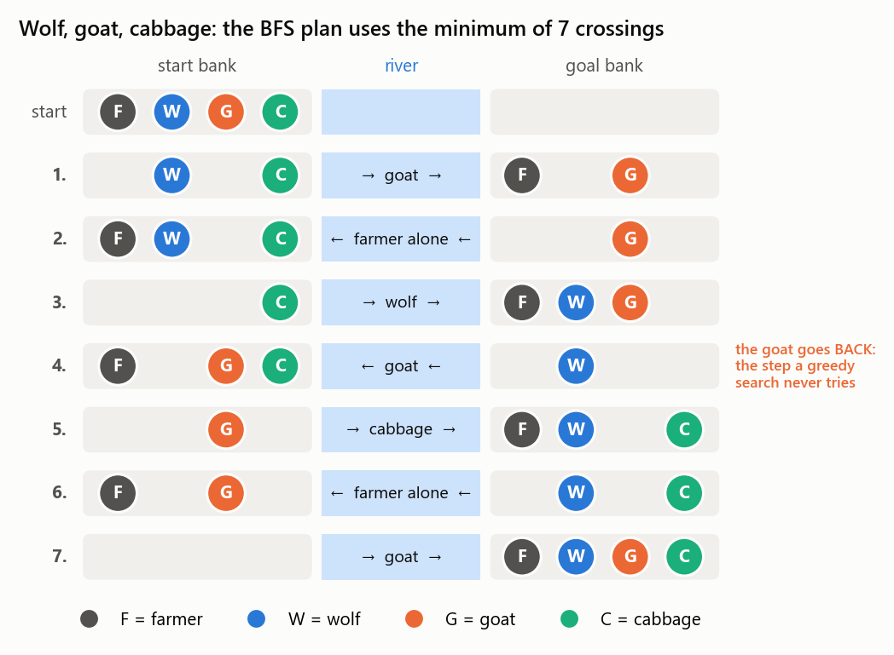

The key idea BFS discovers is in step 4: the goat must be brought **back**. A greedy approach
("always move something forward") cannot find this.

The whole state space is small enough to draw. BFS visits all 10 safe states level by level.
The two shortest plans split after crossing 2 (take the wolf or the cabbage next) and join
again at crossing 5:

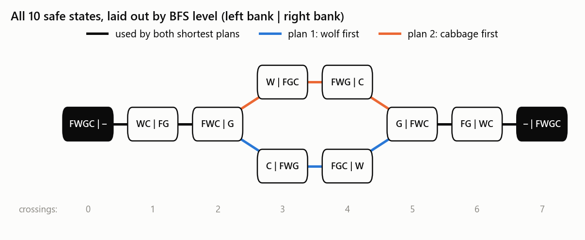

* plan 1: goat, alone, **wolf**, goat, **cabbage**, alone, goat
* plan 2: goat, alone, **cabbage**, goat, **wolf**, alone, goat

**Complexity:** O(V + E) with V = 16. The state space is tiny; the point is that BFS
*guarantees* the minimum.

---

## 3. Eight Queens — DFS + Backtracking

### 3.1 Model

Exactly one queen goes in each row, so a state is a partial placement
`placement[r] = column of the queen in row r` for rows `0..k-1`. Level `k` of the search tree
answers "which column for the queen in row k?". A leaf at depth 8 is a solution.

### 3.2 Algorithm

DFS places queens row by row. When the new queen conflicts with an earlier one, the **whole
subtree is pruned** and the next column is tried. When no column works, the search
backtracks to the previous row.

Conflicts are checked in O(1) with three sets:

| Set | Meaning | Same for two cells when … |
|---|---|---|
| `cols` | used columns | `c1 == c2` |
| `diag1` | used `r − c` | same "\\" diagonal |
| `diag2` | used `r + c` | same "/" diagonal |

```python
def place(r):
    if r == n:
        solutions.append(tuple(placement)); return
    for c in range(n):
        if c in cols or (r - c) in diag1 or (r + c) in diag2:
            continue                                   # prune
        cols.add(c); diag1.add(r - c); diag2.add(r + c); placement.append(c)
        place(r + 1)
        cols.remove(c); diag1.remove(r - c); diag2.remove(r + c); placement.pop()   # undo
```

### 3.3 Result

All 92 solutions are found with 15,720 column tries (about 2 ms). The first one appears
after 876 tries:

<p align="center">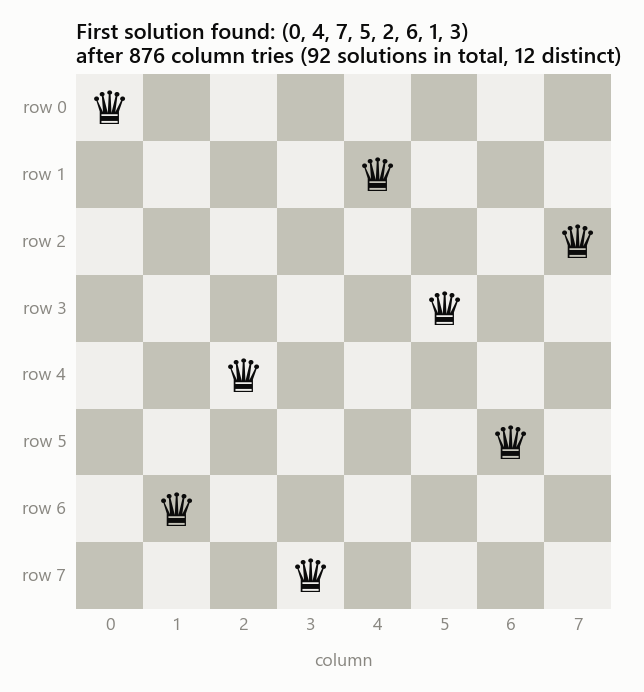</p>

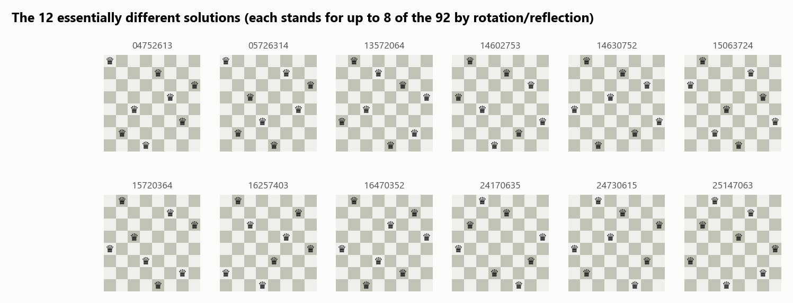

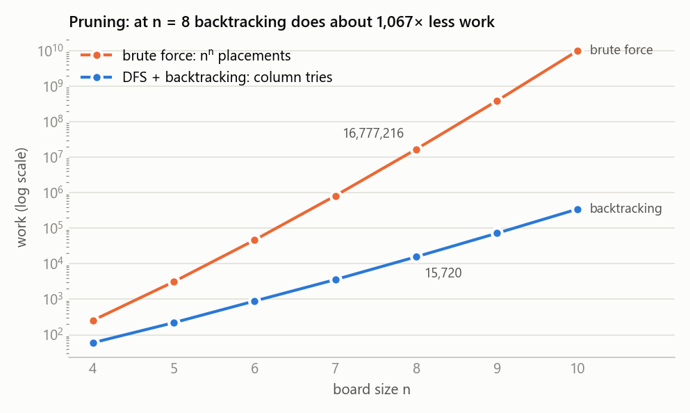

| n | 4 | 5 | 6 | 7 | 8 | 9 | 10 |
|---|---|---|---|---|---|---|---|
| solutions | 2 | 10 | 4 | 40 | 92 | 352 | 724 |
| column tries | 60 | 220 | 894 | 3,584 | 15,720 | 72,378 | 348,150 |

* **Effect of pruning:** brute force (one queen per row, all 8^8 = 16,777,216 placements, then
  check each) also finds 92 solutions, but took **8.3 s**. Backtracking needed 15,720 tries
  and **2 ms**.
* The 12 distinct solutions are counted by mapping each of the 92 to its smallest form under
  the 8 board symmetries (4 rotations × mirror).
* The counts for n = 4…10 match the known values (checked in `test_search.py`).

**Complexity:** worst case O(n!), since columns cannot repeat. Pruning on the diagonals cuts
this a lot in practice. Memory is O(n).

---

## 4. NPC Searching for the Player — A*

### 4.1 Model

A game map with walls `#`, road `.` (cost 1 to enter) and swamp `~` (cost 5, slow). The NPC
`N` must reach the player `P` as cheaply as possible, moving in 4 directions. The 13 × 20 map
is written as text in `MAP_TEXT` and drawn in 4.3.

### 4.2 Algorithm

A* keeps a priority queue (min-heap) ordered by

```
f(n) = g(n) + h(n)
g(n) = real cost from the NPC to n
h(n) = |row − row_P| + |col − col_P|        (Manhattan distance)
```

Every move costs at least 1, so the Manhattan distance **never overestimates** the real
remaining cost. It is *admissible* (and *consistent*), so A* is guaranteed to return the
cheapest path. The heuristic steers the search toward the player, so fewer cells are expanded.

```python
heap = [(h(start), start)];  g = {start: 0}
while heap:
    _, cell = heappop(heap)
    if cell == goal: break
    for nxt in neighbours(cell):
        new_g = g[cell] + COST[nxt]
        if new_g < g.get(nxt, inf):
            g[nxt] = new_g; parent[nxt] = cell
            heappush(heap, (new_g + manhattan(nxt, goal), nxt))
```

The same function also runs **Dijkstra** (priority = `g` only) and **greedy best-first**
(priority = `h` only), for comparison. Plain **BFS** ignores costs.

### 4.3 Result

| Method | Path cost | Steps | Cells expanded |
|---|---|---|---|
| **A\* (Manhattan)** | **35** | 35 | **59** |
| Dijkstra (h = 0) | 35 | 35 | 94 |
| Greedy best-first (h only) | 55 | 31 | 32 |
| BFS (ignores cost) | 55 | 31 | 97 |

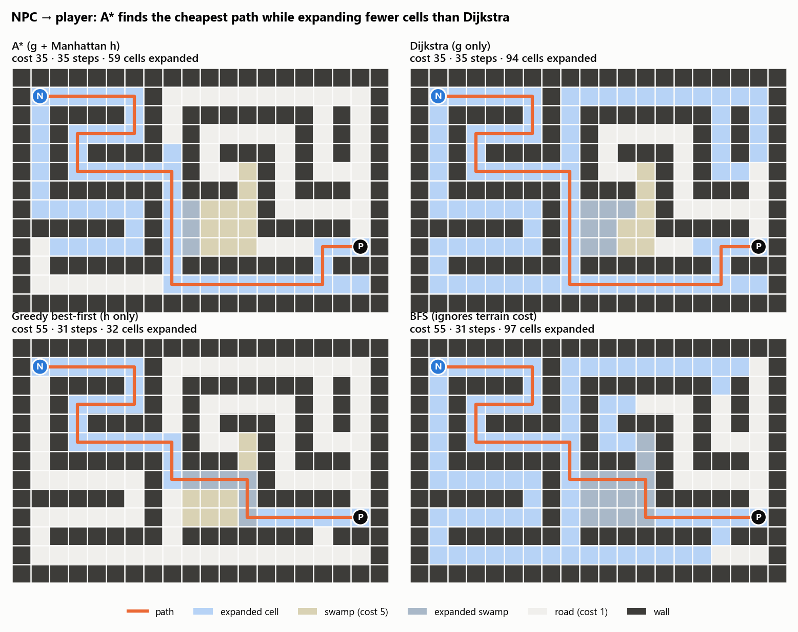

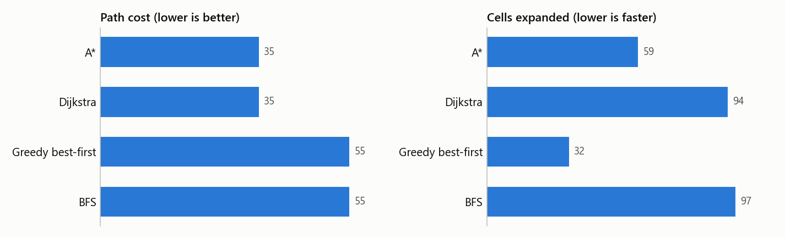

* **A\* vs Dijkstra:** same optimal cost, but A* expanded 37% fewer cells (59 vs 94), because
  `h` stops it from spreading in directions away from the player.
* **Greedy best-first** expanded the fewest cells (32), but it only looks at `h`, so it walks
  straight through the swamp and pays 55. It is fast but not optimal.
* **BFS** finds the fewest *steps* (31) but does not know that swamp is expensive.

### 4.4 Chasing a moving player

In a game the player moves, so the NPC **re-plans with A\* every turn** and takes one step
along the new path. Here the player wanders randomly (it does not know where the NPC is):

<p align="center">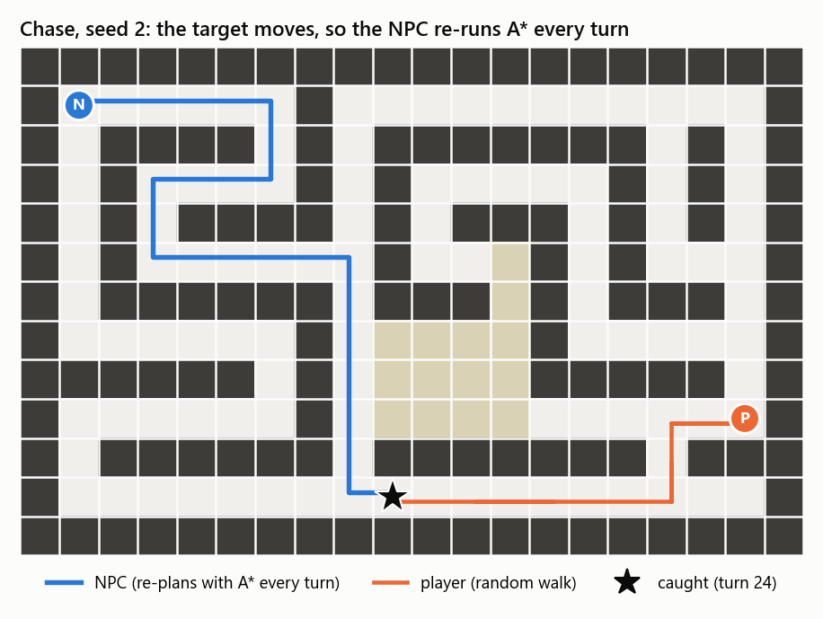</p>

| Seed | 0 | 1 | 2 | 3 | 4 |
|---|---|---|---|---|---|
| Caught after (turns) | 30 | 32 | 24 | 40 | 29 |
| Cells expanded in total | 877 | 1293 | 612 | 1105 | 780 |

Simplification: in the chase, the swamp cost only affects *planning*. The NPC moves one cell
per turn on any terrain.

**Complexity:** O(E log V) with a binary heap. With a consistent heuristic each cell is
expanded at most once.

---

## 5. Wire Routing in IC Design — many methods

### 5.1 Model

The chip is a grid of routing cells on **one metal layer**. `#` cells are blocked (macros or
cells that are already placed). A **net** is a pair of pins that must be joined by a wire of
adjacent cells. Wires of different nets may **not** share a cell, or they would short.
Routing one net is a shortest-path search on the grid. Routing many nets is much harder,
because each wire becomes an obstacle for the others.

### 5.2 Part A — routing one net: five methods

| Method | Idea | Shortest wire? |
|---|---|---|
| **Lee algorithm** (1961) | **BFS** "wave expansion": label every cell with its distance from the source, wave by wave, until the target is reached, then backtrace. | Yes |
| **Hadlock algorithm** (1977) | A step *towards* the target costs 0, a step *away* costs 1 (a "detour"). **0-1 BFS** (a deque: cost-0 to the front, cost-1 to the back) minimises the detour number `d`, and wire length = `MD(s,t) + 2d`. | Yes |
| **Soukup algorithm** (1978) | Neighbours that move towards the target go to the **front** of the queue, so it heads straight at the target **DFS**-style. Other neighbours go to the back (BFS when blocked). Cells are fixed when first seen. | **No** |
| **A\*** | Priority `g + Manhattan distance`, as in Problem 4. | Yes |
| **A\* with bend penalty** | State = `(cell, direction)`. Each step costs 1 and each change of direction costs 5 more. In a real two-layer router every bend is a **via**, which costs area and reliability. | Minimises `length + 5·bends` |

```python
# Hadlock: 0-1 BFS on the detour number
w = 0 if md(n, t) < md(cell, t) else 1
if detour[cell] + w < detour.get(n, inf):
    detour[n] = detour[cell] + w; parent[n] = cell
    (dq.appendleft if w == 0 else dq.append)(n)

# Soukup: go straight at the target first
if md(n, t) < md(cell, t): dq.appendleft(n)    # DFS towards the target
else:                      dq.append(n)        # BFS around obstacles
```

**Chip 1 (open)** — a few macros, but a straight route exists, from (9,0) to (0,19):

| Method | Length | Bends | Cells expanded |
|---|---|---|---|
| Lee (BFS) | 28 | 5 | 136 |
| Hadlock (0-1 BFS) | 28 | 1 | **29** |
| Soukup (DFS+BFS) | 28 | 1 | **29** |
| A* (Manhattan) | 28 | 1 | 114 |
| A* + bend penalty | 28 | 1 | 63 |

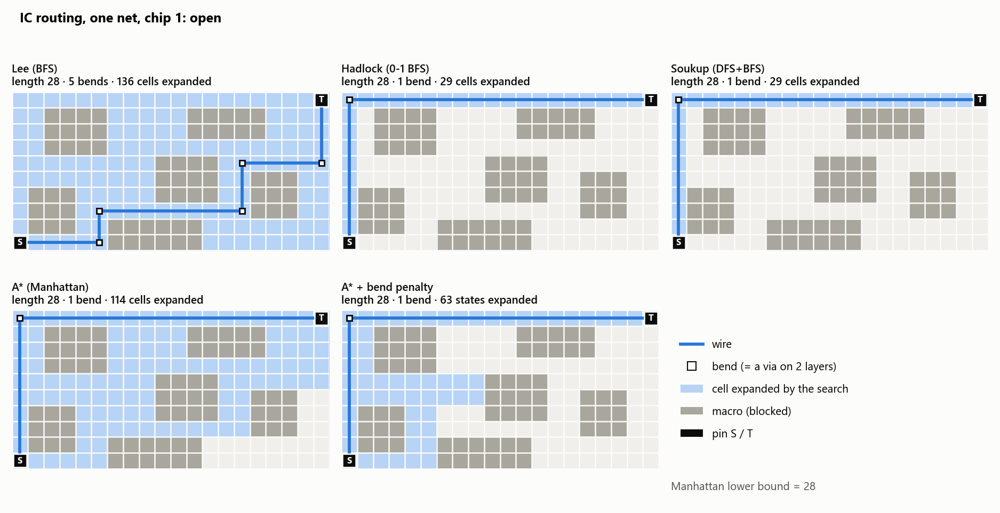

When the way is open, the target-directed methods (Hadlock, Soukup) go straight to the target
and expand only the 29 cells of the wire. Lee floods 136 cells.

**Chip 2 (blocked)** — the macros block every monotone path, from (6,0) to (6,19):

| Method | Length | Bends | Cells expanded |
|---|---|---|---|
| Lee (BFS) | 29 | 3 | 193 |
| Hadlock (0-1 BFS) | 29 | 8 | 144 |
| Soukup (DFS+BFS) | **31** | 12 | 153 |
| A* (Manhattan) | 29 | 8 | 159 |
| A* + bend penalty | 29 | **2** | 351 (states) |

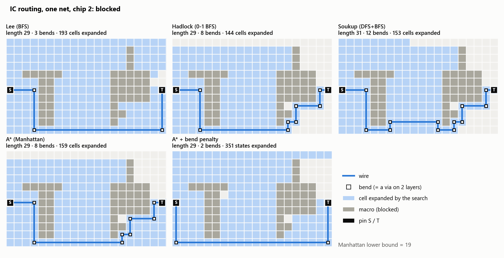

* Lee, Hadlock and A* all reach the optimum 29. They can choose different shortest wires, with
  very different bend counts (3 vs 8).
* Soukup's DFS rushes into the gap at the bottom and fixes cells too early, so its wire is
  2 longer and has 12 bends.
* The bend-penalty A* gets the same length with only **2 bends**. It explores more states,
  because each cell is stored up to 4 times (once per direction).
* On 97 routable random nets (`test_search.py`): Lee, Hadlock and A* were always shortest.
  Soukup was longer in 2 cases. The bend-penalty router picked a slightly longer wire to save
  bends in 5 cases. It never had more bends than any shortest path.

### 5.3 Part B — routing many nets

Routers usually route nets **one at a time**: every finished wire becomes an obstacle. Three
strategies:

1. **Sequential, given order.**
2. **Sequential, shortest nets first** — a common net-ordering heuristic. Short nets have few
   alternative routes, so they should choose first.
3. **Rip-up and reroute.** When a net cannot be routed, route it *through* the other wires
   at a penalty. Then **rip up** the nets it crosses and put them back in the queue. Cells
   that were fought over get a growing **history cost**, so later routes learn to avoid them.
   This is the idea behind negotiation-based routers such as PathFinder. The best legal state
   seen is returned.

```python
path = astar(grid, s, t, forbidden=pins_of_others | other_wires, cell_cost=history)
if path is None:
    path = astar(grid, s, t, forbidden=pins_of_others,
                 cell_cost=lambda c: history[c] + (5 if c in owner else 0))
    for v in nets_on(path):          # rip up the nets in the way
        remove(v); queue.append(v)   # ...and reroute them later
    history[conflict cells] += 1
```

**Small example** — net A must cross the chip, and the pins of B and C sit on its straight
path:

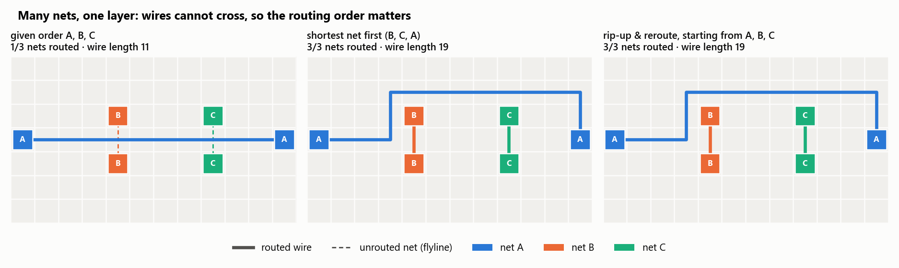

With one layer, wires cannot cross. If A is routed first along its shortest path, it walls
off B and C (their dashed flylines stay unrouted). Routing short nets first fixes this.
Rip-up fixes it **even with the bad order**. B fails, so it routes through A and A is ripped
up. Then C is routed, and A is rerouted around both (total wire 19):

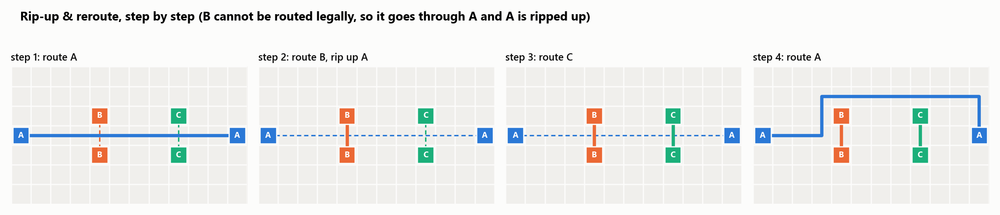

**Random benchmark** — 200 chips, 12×12, 4 random macros, 6 nets with random pins:

| Strategy | Nets routed | Chips fully routed |
|---|---|---|
| Sequential, given order | 846 / 1200 | 25 / 200 |
| Sequential, shortest first | 951 / 1200 | 39 / 200 |
| **Rip-up & reroute** | **1038 / 1200** | **78 / 200** |

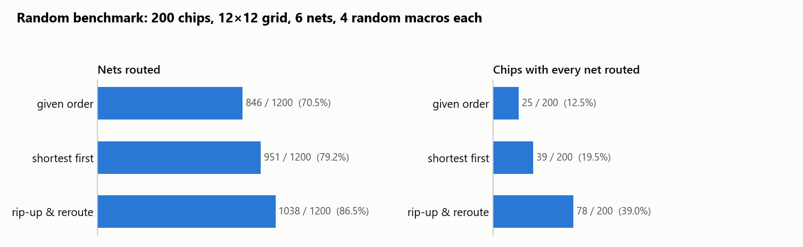

Rip-up & reroute doubles the number of fully routed chips. It costs more time, though: almost
all of the script's ~8 s goes to the 200 rip-up runs. Many random chips are probably
**impossible** on one layer (two nets whose pins interleave must cross), so 78/200 is not
"rip-up fails 61% of the time". I did not compute the true optimum for each chip. Every
reported routing is checked by `check_routes`: each wire is connected, joins its own pins,
avoids macros, and causes no short.

**Complexity:** Lee, Hadlock and Soukup are O(N) for N grid cells. A* is O(N log N). The
bend-penalty A* has 4N states. Lee's main drawback in real chips is **memory and time on huge
grids**, which is why industrial routers use target-directed search (Hadlock/A*), coarse global
routing first, and multiple layers.

---

## 6. Comparison of the Search Methods

| Method | Data structure | Order of exploration | Finds the optimum? | Memory | Used for |
|---|---|---|---|---|---|
| DFS | stack / recursion | deepest first, backtrack | No (any solution) | O(depth) | maze, eight queens, Soukup |
| Backtracking | DFS + pruning | DFS, cut invalid subtrees | finds all solutions | O(depth) | eight queens |
| BFS | queue (FIFO) | level by level | Yes, fewest steps (unit cost) | O(width) — all of a level | river crossing, Lee |
| 0-1 BFS | deque | cost-0 edges first | Yes, for 0/1 edge weights | O(N) | Hadlock |
| Dijkstra | priority queue by `g` | cheapest so far | Yes, any non-negative cost | O(N) | baseline for A* |
| Greedy best-first | priority queue by `h` | looks closest to goal | No | O(N) | fast but risky |
| A* | priority queue by `g + h` | cheapest total estimate | Yes, if `h` is admissible | O(N) | NPC, IC routing |

When to use what:

* Need **any** solution, or **all** solutions, and the tree is deep → **DFS / backtracking**.
* Need the **fewest moves** and every move costs the same → **BFS**.
* Moves have **different costs**, and you can estimate the distance to the goal → **A\***.
  With `h = 0` it becomes Dijkstra.
* **Many interacting searches** (many nets) → a single search is not enough; you also need
  *ordering* and *rip-up & reroute*.

## 7. Verification

`python test_search.py` → `all 6 tests passed`. It checks:

* the maze paths are valid and simple, BFS ≤ DFS in length, and an unreachable exit returns `None`;
* the river plan has 7 legal, safe crossings, and there are exactly 2 shortest plans;
* the queens give 92 valid solutions and 12 up to symmetry, the counts for n = 4…10 are right,
  and brute force on n = 6 agrees;
* A* = Dijkstra cost on the NPC map and on 30 random weighted maps, and A* expands ≤ Dijkstra;
* on 100 random single-net chips, Lee = Hadlock = A* = shortest, Soukup ≥ shortest, and the
  bend-penalty router has the lowest `length + 5·bends`;
* the A/B/C example behaves as described, and on 50 random 6-net chips every sequential and
  rip-up routing passes `check_routes` (connected wires, no shorts).

## 8. Limitations

* The maps are small and hand-made (except the random routing benchmark). Times are from one
  machine with Python overhead, so only the counts of expanded cells should be compared.
* The DFS path depends on the neighbour order (right, down, left, up). Another order gives a
  different path.
* The IC model is a simplified one: one layer, two-pin nets, unit grid. Real routers handle
  multi-pin nets (Steiner trees), many layers with vias, design rules and timing.
* Rip-up parameters (penalty 5, 300 iterations) were picked by a quick trial on the benchmark,
  not tuned carefully.
